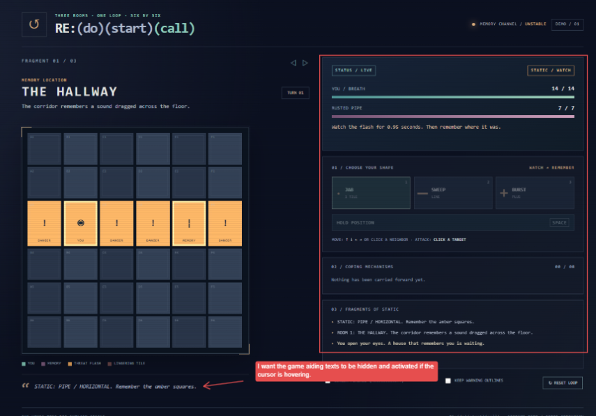

# RE:(do)(start)(call)

> **A 6×6 turn-based psychological roguelike about memory, hypervigilance, and learning to reach out.**

**Current delivery:** three-room **house demo, implemented in Godot 4 and as a playable browser companion**, with deterministic game-engine tests. The official repository is **[arbiesantinocastillo90-hub/RE-do-start-call](https://github.com/arbiesantinocastillo90-hub/RE-do-start-call)**. The game title retains its distinctive punctuation; GitHub uses a compatible repository slug.

## Play it now

### Instant browser demo — no Godot required

For local play, open **`web/index.html`** in a modern browser. Alternatively run
`python -m http.server 8000` from the repository root and open
`http://localhost:8000/`; the root entry forwards to `./web/`.
The game needs no account, backend, or runtime library downloads.

Select a shape (circle, diamond or star) and a tint, review **How to Play**
or **Content Notice**, adjust accessibility and audio, and choose
**START NEW LOOP**. Memorize the briefly flashed attack squares. When they
disappear, move once (or HOLD), select an attack and click/tap/aim at a target.
Choose one of three coping modifiers after each of the first two rooms, then
clear the third room for the demo-only completion screen. During a run,
**R / Escape / SETUP** opens a confirmation before discarding progress.

### Godot 4 project

1. Open Godot 4.x → Import → `project.godot`.
2. Run the project (F5) or `scenes/main.tscn` (F6).
3. Arrow keys / clicking adjacent squares to move; Space to hold; 1/2/3 select Jab/Sweep/Burst; click an attack target; E/F trigger ability when unlocked; R restarts.
4. Headless Godot 4.4.1 import/script parsing and regression tests are tracked
   in GitHub Actions, but **native GUI playthrough, keyboard focus in the
   running app and tested Windows export** remain separate release gates.
   Do not treat a headless green check as a fully tested Windows build.

## Pitch

A boy runs away from home in a burst of emotion. When he opens his eyes, a fractured dimension has rebuilt places from his memory. The turn-by-turn world is not literal time stop; it dramatizes hypervigilance: learned attention to danger. Enemies have fixed attack sequences; warning squares flash briefly before the child's movement decision, and the player must recall them. Attacks poison future tile choices, and powerful upgrades always involve a tradeoff. `(call)` foreshadows that the full game's hopeful conclusion is about accepting help — not destroying another person.

**Content note:** The story references childhood distress, abuse, and isolation. Its environments portray distress through symbolism, not graphic scenes. No abuser appears as a literal boss.

## Delivered demo mechanics

| System | Implementation |
|---|---|
| Board and turns | 6×6, cardinal move or hold, then attack, then enemy strike |
| Attack shapes | Jab (single), Sweep (three-tile line), Burst (plus) |
| Memory tells | Fixed, learnable attacks: show tiles → hide → player acts → same tiles strike |
| Persistent tile effects | Player splinter/spark/burn traces and enemy rust/drip/echo |
| Room 1 | Rusted Pipe, horizontal/vertical attacks |
| Room 2 | Melted Hanger, diagonal attacks and slowdown |
| Room 3 | Unanswered Call miniboss, crosses/diagonals/rings |
| Modifier rewards | Choose one of 3 random options after rooms 1 and 2, from 8 mechanisms |
| Life cycle | Room transitions, HP, death/restart, demonstration win screen |
| Browser accessibility | Longer warnings, optionally retaining threat outlines |

The **browser build** includes a responsive and focusable 6×6 board, hover
attack previews, accessible warning symbols, optional hidden-by-default
**MEMORY TRACE** logs/hints, three cosmetic shapes and tints, keyboard/touch
controls, reduced-motion and warning options, local-only allowlisted
preferences, independent mute and volume, and bounded visual/audio feedback.
The **Godot build** contains a generated flat-shape tactical interface;
native GUI/export usability still needs manual validation.

## Run the tests

Requires Node.js for deterministic test execution:

```bash
node --check web/engine.js
node --check web/preferences.js
node --check web/effects.js
node --check web/app.js
node tests/engine.test.js
node tests/autoplay.test.js
node tests/ui_contract.test.js
node tests/preferences.test.js
node tests/effects.test.js
npm install --no-save @playwright/test@1.56.1
npx playwright install chromium
npx playwright test tests/ui_browser.spec.cjs tests/setup_browser.spec.cjs tests/effects_browser.spec.cjs tests/release_menu_browser.spec.cjs --workers=1
```

Branch CI has run **14 engine tests**, **60 seeded complete victories**, 12
frozen encounter patterns and their warning-to-strike parity fixtures,
**8 preference tests**, and **10 real Chromium Playwright cases**. See the
[Release A browser UX verification report](docs/WEB_RELEASE_UX.md) for exact
runs, coverage, known gaps and manual checks. Green branch CI does not prove
the merged release or the actual Windows/browser public deployment is verified.

For Godot, after installing version 4:

```bash
godot --headless --path . --editor --quit
godot --headless --path . --script res://tests/test_geometry.gd
```

## Files

```text
RE-do-start-call/
├── project.godot
├── scenes/main.tscn
├── scripts/
│   ├── main.gd                 Godot UI and battle loop
│   ├── attack_patterns.gd      Attack geometry
│   ├── encounter_data.gd       Three rooms / deterministic threats
│   └── modifiers.gd            Eight boon-with-cost options
├── web/
│   ├── index.html              Play locally
│   ├── style.css / effects.css Visual styling and bounded effects
│   ├── engine.js               Pure, testable game state machine
│   ├── preferences.js           Allowlisted browser-only settings
│   ├── effects.js               Cosmetic presentation / optional sound
│   └── app.js                   Browser UI
├── tests/
│   ├── engine.test.js           Deterministic engine assertions
│   ├── autoplay.test.js         60 full-run reachability tests
│   ├── preferences.test.js      Saved settings and blocked storage
│   ├── release_menu_browser.spec.cjs  Chromium menu/reset cases
│   └── test_geometry.gd         Godot geometry assertions
├── docs/
│   ├── GAMEPLAY_IMPLEMENTATION.md
│   ├── DEMO_SPEC.md
│   ├── GPT_INTERFACES.md
│   ├── FULL_GAME_ROADMAP.md
│   ├── ORCHESTRATION.md
│   └── QA_CHECKLIST.md
└── .github/workflows/tests.yml
```

## What is not in the current demo

The full game’s void hub, branching room map, school, snow park, up-to-five worlds, ice-cream shop, rewind, permanent memory skills and canonical endings are **designed but not playable** in this demo. See [full game roadmap](docs/FULL_GAME_ROADMAP.md). The house demo ends on a non-canonical completion message.

## GPT development interfaces

Four independent GPT chat interfaces were created inside the user-shared Canvas Live workspace and given implementation assignments. They are separate GPT conversations, **not guaranteed autonomous filesystem/GitHub agents**. The source directory here is the tested integration artifact; a chat response isn't automatically merged code. See [GPT_INTERFACES.md](docs/GPT_INTERFACES.md).

## GitHub

The authoritative repository **exists** at
[arbiesantinocastillo90-hub/RE-do-start-call](https://github.com/arbiesantinocastillo90-hub/RE-do-start-call).
GitHub Actions runs Node/Chromium checks and headless Godot testing; its
Pages workflow has produced a successful deployment run, but **the public
browser URL and its actual 3-room playability have not been independently
verified**. Windows distribution and manual native/browser release evidence
are still required before declaring Release A ready.

## UI refinement screenshot (November 17, 2026)

The screenshot below was supplied as design feedback. The red annotations request that in-game hint text and recent-event descriptions become visible on **hover or keyboard focus**, while the status panel shows only essential live information. Put character customization, effects and accessibility settings in the pre-game menu rather than the active combat panel.



See the associated [UI refinement issue](https://github.com/arbiesantinocastillo90-hub/RE-do-start-call/issues) for tracking.
